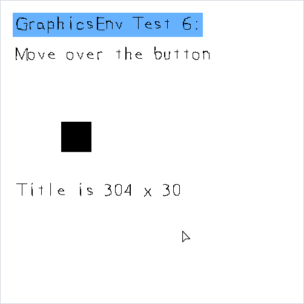
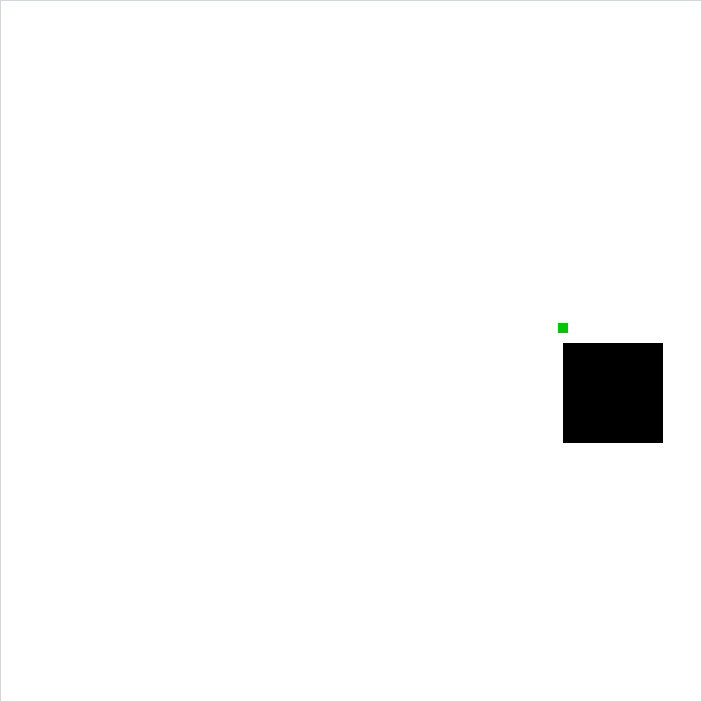
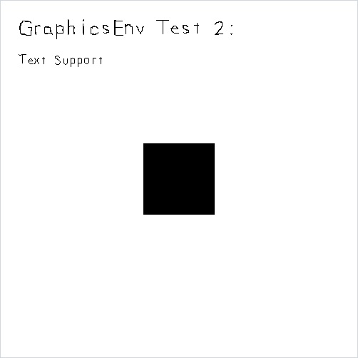
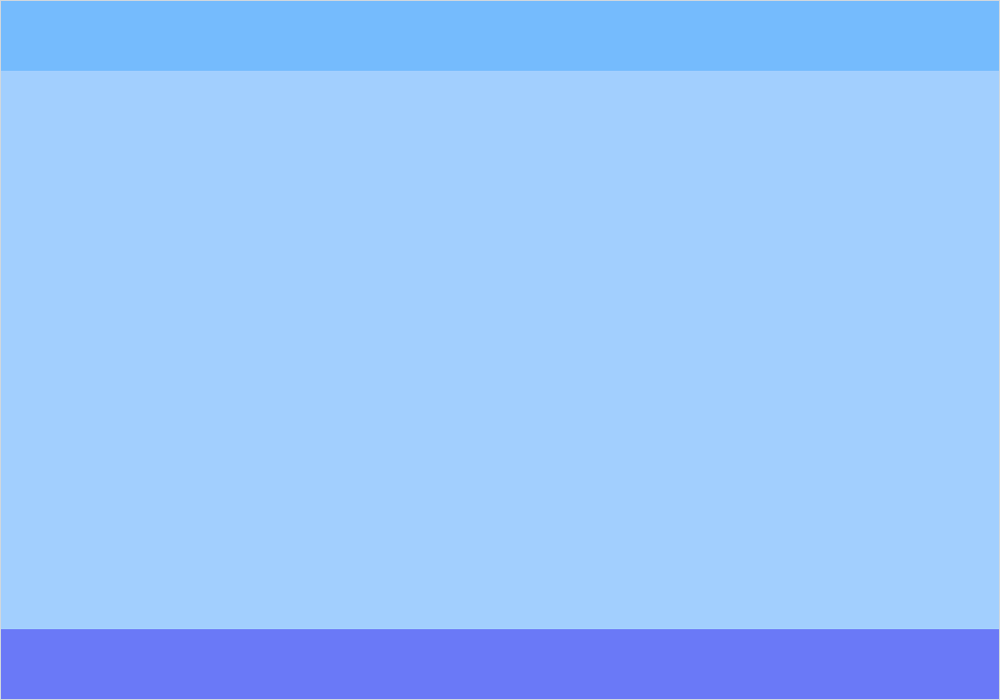

# sdl-assist
This library abstracts out the handling of Simple DirectMedia Layer, providing support for drawing rectangles, text and buttons to the screen.



*The `buttoncallbacks` demo, driven by scripted mouse input: the hover, mouse-down and mouse-up callbacks each rewrite the status label.*

## Dependencies

A C++ compiler (`g++`) and the SDL2 development packages:

```
sudo apt-get install libsdl2-dev libsdl2-image-dev libsdl2-ttf-dev
```

The same three packages are installed by `.devcontainer/Dockerfile` and by the
build workflow in `.github/workflows/build.yml`, so opening this repository in
the dev container provides a ready environment.

## Building

There is no library artifact to install. The build compiles the library sources
together with each demo program:

```
make -C src/tests all
```

This produces six executables in `src/tests/`:
`init_test_executable`, `rectangles_test_executable`, `renderpage_test_executable`,
`text_test_executable`, `button_test_executable` and `buttoncallbacks_test_executable`.

To remove them:

```
make -C src/tests clean
```

## Demo programs

Each program under `src/tests/` is a standalone `main()` that opens a real
window and runs until it receives `SDL_QUIT`, so a display is required to run
them. Building them does not require a display.

Run them from the repository root (for example `./src/tests/text_test_executable`)
so that the default font path `src/fonts/lazy.ttf` resolves; see
[Fonts](#fonts) below.

| Target | Source | What it demonstrates |
|--------|--------|----------------------|
| `init` | `testInit.cpp` | The minimal lifecycle: a 400x400 window with one black rectangle centered on a white background, which keeps drawing after a second, never-initialized environment is destroyed. |
| `rectangles` | `testRectangles.cpp` | Animation via `drawRectangle` — a black square moves toward a small green target that relocates to a random position each time it is reached. |
| `renderpage` | `testRenderPage.cpp` | Layout with rectangles — header, body and footer bands drawn in three shades of blue. |
| `text` | `testText.cpp` | `Text` rendering — two labels drawn with the font and renderer taken from the environment, the second after the font is reloaded at a smaller size. |
| `button` | `testButton.cpp` | `Button` rendering and event handling — clicking the button runs a callback that rewrites a neighbouring `Text` label. |
| `buttoncallbacks` | `testButtonCallbacks.cpp` | The `Button` callback setters and the `Text` getters — hover, mouse-down and mouse-up callbacks attached with `setHoverFunction`, `setMouseDownFunction` and `setMouseUpFunction` each rewrite a status label, and the title label is outlined and measured using `getX`, `getY`, `getWidth` and `getHeight`. |

### Screenshots

| `rectangles` | `text` | `renderpage` |
|---|---|---|
|  |  |  |

These images were captured from the demo programs above, built from this
repository and run under a virtual X display. `docs/capture.sh` rebuilds the
demos, drives them with `xdotool` and regenerates every file in
`docs/images/`; it needs `Xvfb`, `xdotool` and ImageMagick in addition to the
SDL2 build dependencies. The pointer drawn in the GIF marks the scripted cursor
position, since the virtual display does not render a cursor.

## Usage

Consuming projects compile the library sources directly alongside their own,
as `src/tests/Makefile` does:

```
g++ main.cpp path/to/sdl-assist/src/GraphicsEnv.cpp \
              path/to/sdl-assist/src/Text.cpp \
              path/to/sdl-assist/src/Button.cpp \
              -lSDL2main -lSDL2 -lSDL2_image -lSDL2_ttf -o my_program
```

A minimal program follows the shape used by every demo:

```cpp
#include "path/to/sdl-assist/src/header/GraphicsEnv.h"

int main(int argc, char* args[]) {
	GraphicsEnv environment;

	environment.setTitle("My Program");
	environment.setScreenWidth(400);
	environment.setScreenHeight(400);

	environment.init();
	environment.loadMedia();

	while (environment.isRunning()) {
		while (environment.pollEvent() != 0) {
			if (environment.getEvent()->type == SDL_QUIT) {
				environment.setRunning(false);
			}
		}

		environment.setRenderColor(0xFF, 0xFF, 0xFF, 0xFF);
		environment.clear();

		environment.setRenderColor(0x00, 0x00, 0x00, 0xFF);
		environment.drawRectangle(environment.getW()/2 - 50, environment.getH()/2 - 50, 100, 100);

		environment.present();
	}

	environment.cleanUp();
}
```

`init()` reports any SDL or SDL_ttf failure to `log.txt` and leaves
`isRunning()` false, so the loop above exits immediately instead of drawing
through a renderer that was never created. `cleanUp()` may be called more than
once — the destructor calls it too — and has no further effect after the first.
It shuts down only the SDL and SDL_ttf initialization that this environment's
own `init()` performed, so destroying an environment that was never
initialized, or cleaning up one of two environments, leaves the other running;
SDL is shut down completely once no initialized environment remains.
A second `init()` while the window is open is reported to `log.txt` and
otherwise ignored; call `cleanUp()` first to initialize the environment again.

`setTitle()`, `setScreenWidth()` and `setScreenHeight()` configure the window
that `init()` creates. Called while the window is open, they retitle or resize
it in place, so `getW()` and `getH()` keep describing the real window. A window
manager may still decline the resize (for example while the window is
maximized), in which case `getW()` and `getH()` report the requested size.

`Text` and `Button` are constructed separately and wired to the environment's
renderer and font:

```cpp
SDL_Color textColor = {0x00, 0x00, 0x00, 0xFF};

Text label;
label.init(25, 25, environment.getFont(), environment.getRenderer(), "Hello", textColor);

Button button;
button.init(100, 200, 50, 50, environment.getRenderer(), &onMouseDown);
```

Both are rendered inside the main loop with `label.render()` and
`button.render()`; `button.handleEvent(environment.getEvent())` is called from
the event loop so the button can react to the mouse. Each event is hit-tested
against the pointer position it carries, not the current mouse state, so every
queued event drained in one frame is tested where it actually happened.
`button.render()` fills the button in black and then restores the draw color
that was current before it, so a later `clear()` or `drawRectangle()` still
uses the color last passed to `setRenderColor()`.

A `Text` holds an `SDL_Texture` that belongs to the environment's renderer, so
it must be released before `cleanUp()` destroys that renderer — either by
calling `label.free()` first, as the demos do, or by letting the `Text` go out
of scope before `cleanUp()` runs. A `Text` that is destroyed after `cleanUp()`
passes its texture to SDL after `SDL_Quit()`. `free()` keeps the label's
position, so a later `loadText()` redraws the new string in the same place.

`GraphicsEnv` and `Text` own the SDL resources they create, so neither can be
copied or assigned; pass them by reference or pointer instead. `Button` holds
no owned resources and remains copyable.

## Fonts

`GraphicsEnv::loadMedia()` opens the file named by `setFontPath()`, which
defaults to `src/fonts/lazy.ttf` — the font shipped with this repository. The
path is passed to SDL_ttf as given, so a relative path resolves against the
working directory; a consuming application should call
`environment.setFontPath("path/to/font.ttf")` before `loadMedia()` with a path
that is valid from wherever it is launched. `setFontSize()` must also precede
`loadMedia()`, since the size is fixed when the font is opened; a call made
after the font is open is reported to `log.txt` and leaves the open font at its
original size until `loadMedia()` is called again.

Calling `loadMedia()` a second time closes the font it opened before and opens
the current path and size in its place, so `getFont()` then returns a new
pointer. A `Text` keeps whatever it has already drawn, but one that was given
the old pointer must be re-pointed with `label.setFont(environment.getFont())`
before its next `loadText()`, since the old font has been closed. The `text`
demo reloads the font this way.

If the font cannot be opened, the failure and the path that was tried are
reported to `log.txt` and the environment is left intact: the window opens and
rectangles draw, but `getFont()` returns `NULL` and any `Text` initialised with
it renders nothing. `log.txt` is only open between `init()` and `cleanUp()`, so
a failure from a `loadMedia()` called before `init()`, or after an `init()`
that failed, is reported through `SDL_LogError()` (standard error by default)
instead.

## License

MIT — see [LICENSE](LICENSE) and [COPYRIGHT.md](COPYRIGHT.md).
